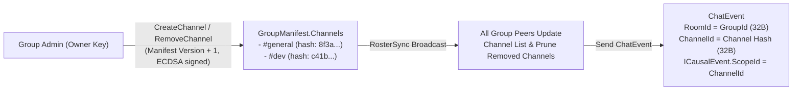

# Admin-Managed Group Channels (`#name` + Hash ID, Default `#general`)

## Goal Description

Allow the group administrator (owner) to create and remove text channels within a governed group:
1. **Default `#general` channel at group creation**: Every newly created group starts with a `#general` channel in its signed `GroupManifest`.
2. **Channel Identity (`#name` + SHA-256 `ChannelId` hash)**:
   - Each channel has a human-readable normalized name (e.g. `general`, displayed as `#general`) and a deterministic 32-byte SHA-256 hash ID:
     $$\text{ChannelId} = \text{SHA-256}(\text{UTF8}(\text{GroupId} \mathbin{\Vert} \text{":\#"} \mathbin{\Vert} \text{normalizedName}))$$
3. **Owner-Signed Channel Creation & Removal**:
   - Creating or removing a channel increments `GroupManifest.Version`, updates `GroupManifest.Channels`, signs the new manifest with the group authority private key (`OwnerPrivateKeyPkcs8Base64`), persists it to the vault, and broadcasts the updated `GroupRosterSyncPayload` to all group peers.
4. **Messages Carry the Channel Hash ID**:
   - Every `ChatEvent` inside a group carries the 32-byte `ChannelId` hash (included in its ECDSA-signed canonical bytes and scoped in `CausalDagState<ChatEvent>`), so each channel has its own independent causal DAG and stream `0x02` topological slice sync.



---

## User Review Required

> [!IMPORTANT]
> **Design Details for Confirmation**
> 1. **Removing `#general` or the last remaining channel**:
>    - Should we require that a group always keeps at least **1 channel** (or protect `#general` from being deleted, or allow deleting `#general` as long as at least one other channel exists)? Proposed: require at least 1 channel to remain in the group, and if the active channel is removed, automatically switch the UI to the first remaining channel (e.g. `#general`).
> 2. **What happens to local chat history when a channel is removed**:
>    - When an admin removes a channel and broadcasts the new manifest, should peers also purge that removed `ChannelId`'s in-memory DAG and reject any future `ChatEvent`s targeting the removed `ChannelId`? (Proposed: **Yes**, reject any incoming `ChatEvent` whose `ChannelId` is not in `CurrentManifest.GetEffectiveChannels()`, and remove the deleted channel's in-memory DAG).

---

## Proposed Changes

### 1. Channel Hash ID, Manifest Serialization & Validation (`Whispernet.Core`)

#### [MODIFY] [ProtocolTypes.cs](file:///home/arvo/Documents/Projects/P2P/Whispernet/src/Whispernet.Core/ProtocolTypes.cs)
- Add `ChannelId` value type (64 lowercase hex characters / 32 bytes) with:
  - `ChannelId.NormalizeName(string rawName)` (strips leading `#`, trims, lowercases).
  - `ChannelId.FromGroupAndName(GroupId groupId, string rawName)` computing `SHA-256("{groupId.Value}:#{normalizedName}")`.
  - `ChannelId.DefaultGeneralFor(GroupId groupId)` $\rightarrow$ `FromGroupAndName(groupId, "general")`.
- Add `GroupChannel(ChannelId ChannelId, string Name, DateTimeOffset CreatedAtUtc)`.

#### [MODIFY] [GroupGovernanceTypes.cs](file:///home/arvo/Documents/Projects/P2P/Whispernet/src/Whispernet.Core/GroupGovernanceTypes.cs)
- Add `IReadOnlyList<GroupChannel>? Channels = null` to `GroupManifest`:
  - Add `GetEffectiveChannels()` returning `Channels` when non-empty, or `[new GroupChannel(ChannelId.DefaultGeneralFor(GroupId), "general", IssuedAtUtc)]` when null/empty.
  - Include `Channels` in `GroupManifest.BuildSignableBytes()` (when `Channels is not null`, serialize count + each `(ChannelId.Value, Name, CreatedAtUtc.UtcTicks)`) so the channel list is protected by the owner's ECDSA signature.

#### [MODIFY] [GroupGovernanceEngine.cs](file:///home/arvo/Documents/Projects/P2P/Whispernet/src/Whispernet.Core/GroupGovernanceEngine.cs)
- In `TryValidateManifest`:
  - Verify that `manifest.GetEffectiveChannels()` has at least 1 channel, no duplicate `ChannelId`s, and that each channel satisfies `ch.ChannelId == ChannelId.FromGroupAndName(manifest.GroupId, ch.Name)`.
- Add `GroupGovernanceEngine.IsValidChannel(GroupGovernanceState state, ChannelId channelId)` checking that `channelId` exists in `state.CurrentManifest.GetEffectiveChannels()`.

#### [MODIFY] [ChatEvent.cs](file:///home/arvo/Documents/Projects/P2P/Whispernet/src/Whispernet.Core/ChatEvent.cs)
- Add `byte[]? ChannelId = null` to `ChatEvent` (with `EffectiveChannelId` returning `ChannelId` if 32 bytes, or `Core.ChannelId.DefaultGeneralFor(new GroupId(RoomIdHex)).ToBytes()` for backward compatibility).
- Update `ICausalEvent.ScopeId` on `ChatEvent` to return `EffectiveChannelId` so `CausalDagState<ChatEvent>` (`ChatRoomDagState`) validates and orders each channel's DAG by its 32-byte channel hash ID.
- Include `ChannelId` in `ChatEvent.BuildSignableBytes` when present so the channel hash ID is cryptographically bound to the author's ECDSA signature.

---

### 2. Admin Channel Creation/Removal, Wire Sync & SQLite Persistence (`Whispernet.App.Messaging`)

#### [MODIFY] [GroupGovernanceService.cs](file:///home/arvo/Documents/Projects/P2P/Whispernet/src/Whispernet.App.Messaging/GroupGovernanceService.cs)
- In `CreateGroupAsync`: populate `Channels` with `[new GroupChannel(ChannelId.DefaultGeneralFor(groupId), "general", nowUtc)]`.
- Add `CreateChannelAsync(AccountSession ownerSession, GroupGovernanceState state, string channelName, CancellationToken ct = default)`:
  - Verifies the caller has the group owner private key in their vault, normalizes `channelName`, computes `ChannelId.FromGroupAndName(state.GroupId, channelName)`, appends the new `GroupChannel`, increments `Manifest.Version`, signs and applies the new `GroupManifest`, and persists to the vault.
- Add `RemoveChannelAsync(AccountSession ownerSession, GroupGovernanceState state, string channelNameOrId, CancellationToken ct = default)`:
  - Resolves the target channel by `#name` or `ChannelId` prefix, ensures at least 1 channel remains in the group, removes the channel, increments `Manifest.Version`, signs and applies the new `GroupManifest`, and persists to the vault.

#### [MODIFY] [GroupMeshService.cs](file:///home/arvo/Documents/Projects/P2P/Whispernet/src/Whispernet.App.Messaging/GroupMeshService.cs)
- Add `ChannelId? ChannelId = null` to `ChatDagSyncRequest` and `ChatDagSyncBatch` so stream `0x02` DAG sync requests and batches identify the exact channel hash ID being synced.

#### [MODIFY] [SqliteChatHistoryRepository.cs](file:///home/arvo/Documents/Projects/P2P/Whispernet/src/Whispernet.App.Messaging/SqliteChatHistoryRepository.cs)
- Persist `channel_id TEXT NOT NULL DEFAULT ''` in `chat_events` (auto-migrating existing tables with `ALTER TABLE chat_events ADD COLUMN channel_id TEXT NOT NULL DEFAULT '';` if needed) so messages reload into their exact channel DAG across app restarts.

---

### 3. Linux CLI (`Whispernet.Client.Linux.Cli`) & MewUI GUI (`Whispernet.Client.Linux.Gui`)

#### [MODIFY] [NcursesTui.cs](file:///home/arvo/Documents/Projects/P2P/Whispernet/src/Whispernet.Client.Linux.Cli/NcursesTui.cs)
- Track `_activeChannelId` and `_activeChannelName` (defaulting to `#general` and its `ChannelId` hash when a governed group is created or selected).
- Add `/channel <create <#name> | remove <#name|id> | use <#name|id> | list>`:
  - `/channel create <name>`: calls `_govService.CreateChannelAsync(...)` and broadcasts the new manifest via `_directMesh.BroadcastSyncPayloadAsync(govState.GroupId)`.
  - `/channel remove <name|id>`: calls `_govService.RemoveChannelAsync(...)`, purges the removed channel's DAG, and broadcasts the new manifest.
  - `/channel use <name|id>`: switches the active channel in the current group.
  - `/channel list`: lists all channels in the active group with their `#name` and `ChannelId` hash.
- Key `_roomDags` by `ChannelId.Value` and stamp every outgoing `ChatEvent` with the active channel's 32-byte hash ID.

#### [MODIFY] [WhispernetGuiWindow.cs](file:///home/arvo/Documents/Projects/P2P/Whispernet/src/Whispernet.Client.Linux.Gui/WhispernetGuiWindow.cs)
- In Column 2 (`TEXT CHANNELS`), dynamically render a clickable channel button for every `GroupChannel` in the active group's `CurrentManifest.GetEffectiveChannels()` (`#general`, `#dev`, etc., with its `ChannelId` hash in the tooltip/header).
- When the logged-in user is the group administrator, display an inline `+ Add #channel` input & button and a `×` remove button next to removable channels.
- Key `_roomDags` and the main chat feed by `_activeChannelId`, displaying `#channel-name (ChannelId: 8f3a12..)` in the top channel header.

---

## Verification Plan

### Automated Tests
1. **Unit & Integration Tests (`Tests/InfrastructureTests.cs` & `--test-reopen`)**:
   - Verify that creating a group automatically creates `#general` with `ChannelId == ChannelId.DefaultGeneralFor(groupId)`.
   - Verify that admin `CreateChannelAsync("announcements")` and `RemoveChannelAsync("announcements")` increment `Manifest.Version`, pass `TryValidateManifest`, sync to peers via `ApplySyncPayload`, and isolate `ChatEvent`s by their 32-byte `ChannelId` hash.
   - Verify that non-owners cannot create or remove channels, and that messages sent to a removed `ChannelId` are rejected.
   - Run the full test suite:
     ```bash
     dotnet run --project Tests/Whispernet.csproj --no-build -- test-all
     dotnet src/Whispernet.Client.Linux.Cli/bin/Debug/net10.0/Whispernet.Client.Linux.Cli.dll --test-reopen
     ```
